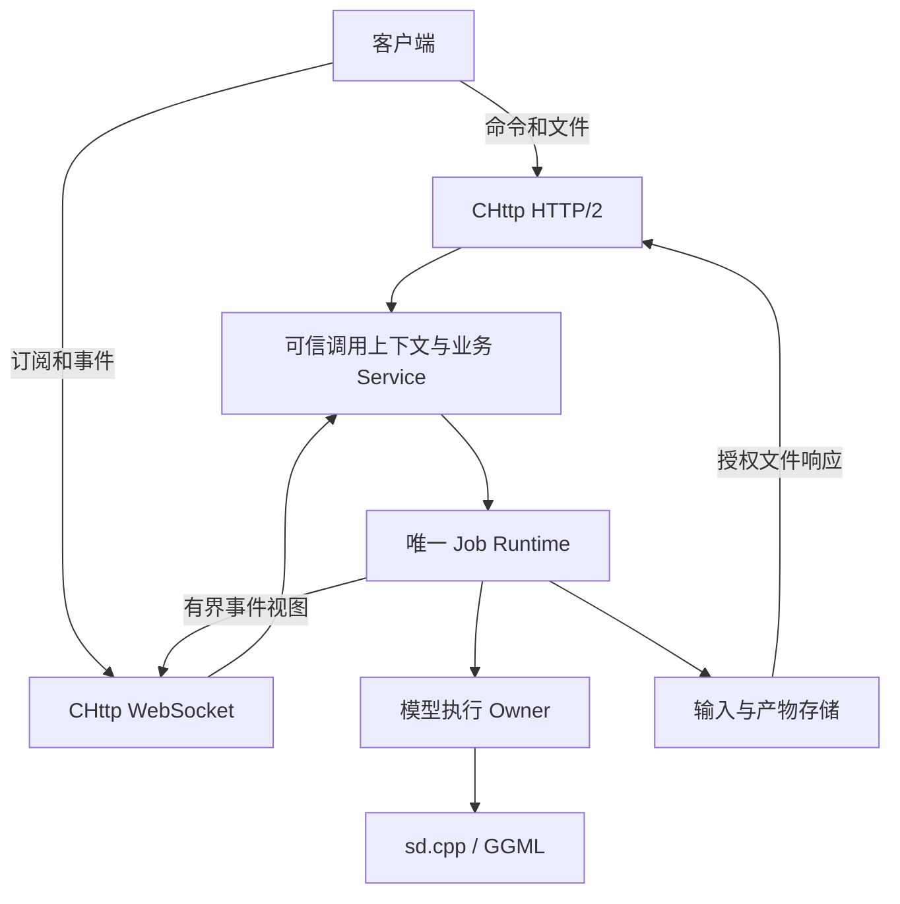
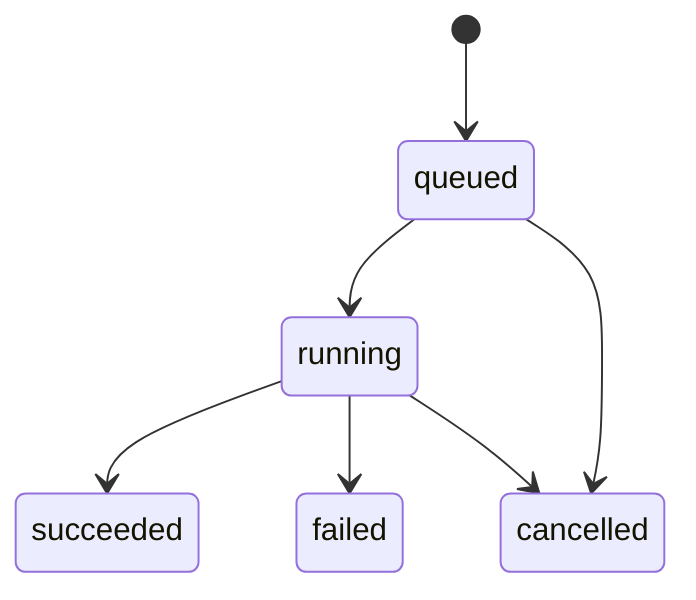

# CHttp 服务设计：认证、任务、状态与产物

## 1. 本轮决定与实际状态

本应用删除 Node.js/pnpm/Vue/Vite 前端，以 CHttp 的完整服务能力为重构起点。
客户端可以是原生程序、脚本或无 Node 构建链的浏览器页面。HTTP/2 承担命令、查询和
文件传输，WebSocket 承担任务事件；模型计算继续调用未修改的 sd.cpp。

**本文是待实施契约与源码审查，不是已注册 API。** 当前 `sd-app-server` 仍是迁入的
httplib 基线；本轮未引入 CHttp SDK，也未实现登录、JobService、产物存储或 WS 订阅。
不以占位实现、将整个任务塞入一个字符串，或另写反射/RPC 框架来绕过共享 Service 缺口。

审查日期：2026-10-29。事实源固定为：

- CHttp master：[`6c8567a350c91701cee276683c972376814417a5`](https://github.com/qigao/chttp/tree/6c8567a350c91701cee276683c972376814417a5)。这是研究基线，尚不是本仓库依赖锁。
- sd 应用基线：[`84bee0182e6e5ea5c820b6c2c0eab334dd8f20b0`](https://github.com/qigao/sd/tree/84bee0182e6e5ea5c820b6c2c0eab334dd8f20b0)。
- sd.cpp：`77b72a2efed78f55de26892c7e909cee001e8b83`，由根 gitlink 选择。

已阅读实际头文件、实现、示例及回归测试；本轮没有重跑 CHttp 自身测试。CodeGraph
在本环境不可用，结构判断依据实际源码检索与调用点。已有测试源码不等于 sd 业务组合已验收。

### CHttp 已有能力与不能扩大承诺的边界

| 能力 | 固定 master 的事实 | 对 sd 的决定 |
| --- | --- | --- |
| HTTP/2 | h2c、TLS ALPN h2、并发 stream、流式 body/source、deferred response | 使用公开 Server/Client；推理不占据网络 owner callback |
| WebSocket | H1 Upgrade 与 RFC 8441 Extended CONNECT；有真实 H2/WSS 测试 | 同一事件协议用于两种 transport；原生 Client/部署显式配置，浏览器由协议栈协商 |
| JWT | HTTP 与 WS 共用 pre-body HS256 Bearer admission | 认证先于重输入处理；角色、任务权限由业务服务判断 |
| Browser App | Session principal、登录时更新 Session ID、CSRF、授权 callback、原生模板与资源服务 | 有浏览器需求时复用；不恢复 Node 应用链 |
| Generated HTTP Service | MethodPlan/native binding、inline/deferred/CFlow/Plugin 模式；当前仅有限单值投影 | 完整 Job JSON/JobSnapshot 所需结构化绑定先补到共享层 |
| Generated RPC | Server/Client 中的 H1/H2 JSON-RPC、有限 typed ingress/egress | 当前没有 WS RPC dispatcher，不把 WS 文本等同于现成 RPC |
| 调用者上下文 | request 有借用 JWT/Session；generated HTTP context flags 必须为 NONE | 先建立可信、独立的 invocation context，不能改共享 execution.context 冒充 |
| Session + defer | 开启 Session 后，该 server 的所有 routed request 都带 Session；defer 返回 `SALTS_ENOTSUP` | 提交/查询/取消使用短 inline 操作；需要 deferred Service 时分实例或先补共享能力 |

证据：[Server API][chttp-http]、[Service API][chttp-service]、[Service 实现][chttp-service-impl]、
[RPC 范围][chttp-rpc]、[Web App API][chttp-web]。

RFC 8441 允许 WS 使用一个 H2 stream，需先协商 `SETTINGS_ENABLE_CONNECT_PROTOCOL`。
CHttp 的 WS pool 已有多 WS session 共用一条 H2 连接的测试，但普通 HTTP client 与 WS pool
是不同公开对象。本文不承诺浏览器 fetch、API 和 WS 必然共享一条物理连接。
参见 [RFC 8441](https://www.rfc-editor.org/rfc/rfc8441) 与 [CHttp WS 测试][chttp-ws-tests]。

## 2. 目标结构与代码归属

以下为目标结构，不代表当前 `apps/server` 已按此拆分：



CHttp 负责协议解析、路由/MethodPlan、认证 admission、Session、请求资源与传输生命周期。
sd 负责模型身份与会话、任务状态、部署配额、输入/结果所有权和业务授权。
同一个业务操作供各种 transport 使用，不为 HTTP、WS、OpenAI 或 SDAPI 分别建立任务队列。

复用 CHttp 的 `.schema`、`.projection.json`、`salts_idl_target(...)`、
`data_bind_http_method_plan_compile_service()`、`chttp_service_mount_http()` 这条生成链。
RPC 使用独立的 `DataBindRpcMethodPlan` 投影，复用同一 native 业务契约；HTTP Plan 与 RPC
Plan 不是同一个对象。当前公开实体是 `chttp_service`，不虚构 `CHttp::IService` 类型。
参见 [Configurator 示例][chttp-configurator] 和 [示例构建][chttp-examples-cmake]。

固定 master 没有可直接依赖的 canonical ServiceHost 公共层。现阶段装配与关闭按已有
Configurator/application owner 示例设计，未来升级共享 ServiceHost 必须明确版本与验收；
不在 sd 复制另一套通用 ServiceHost。

## 3. 客户端如何认证

### 原生客户端与脚本

调用方从配置的可信认证方取得短期访问凭据，在 HTTP 请求和原生 WS 握手中发送
`Authorization: Bearer ...`。CHttp validator 固定预期 issuer、audience、时钟容差和过期要求。
凭据签发端拥有签名密钥，普通客户端不持有 HS256 secret，也不能自行填 subject 来获得权限。

CHttp 当前公开的验证算法是 HS256，不能因为内部 cjwt 实现更多 JOSE 算法，就宣称公网
OIDC/RS256/JWKS 接入已成立。若选定的身份系统使用其他算法，应在共享认证契约中补齐。
账号、密码/MFA 或外部身份提供者的验证由业务认证方负责；CHttp 不自带完整用户数据库。

验证后的 `chttp_jwt_claims_view` 只有 issuer、subject、jti、audience 和时间字段，不能
假定 role/tenant/scope 已存在。应用按可信 `(issuer, subject)` 查自己的授权配置，形成
每次调用独立的身份快照；请求 JSON 中的 `owner`、`tenant`、`role` 不能代替该快照。

### 浏览器客户端

需要网页时，可用 CHttp App 原生页面/资源服务和浏览器自带 fetch/WebSocket。应用验证
凭据后调用 `chttp_web_principal_sign_in()`，由已有实现完成 Session ID 更新和 CSRF 轮换；
退出复用 `chttp_web_principal_sign_out()`。Cookie 使用 HTTPS 对应的 Secure/HttpOnly/
SameSite 策略，修改操作验证 CSRF，WS 握手检查明确的 Origin 允许列表。

浏览器的标准 `WebSocket(url, protocols)` 构造器没有任意 Authorization header 参数，
因此浏览器 Session/WS 是单独、明确的入口策略，不能直接照搬原生客户端的握手代码。
不把长效 token 放进 URL，不在 Bearer 验证失败后改用 Cookie 继续放行。
参见 [WebSockets 标准](https://websockets.spec.whatwg.org/#the-websocket-interface)。

现有 browser auth middleware 未登录时会返回登录跳转；JSON API 必须定义自己的 401/403
响应，不能让客户端收到意外的 HTML/303。当前只要 server 的 `session_capacity` 非零，
该实例所有 routed request 都带非空 Session，即使没有 Cookie 或使用 Bearer，defer 仍返回
`SALTS_ENOTSUP`。第一版通过短 inline 命令接纳、查询和取消，Job Runtime 独立执行长任务；
若业务确需 deferred Service，应明确分离实例或先补齐共享层支持。
参见 [请求 dispatch][chttp-interceptor] 与 [defer 实现][chttp-response]。

WS 握手可以使用 Session，但现有公开 Session API 没有按 Session ID 查询有效性或订阅
撤销的入口，浏览器 principal 也没有 expiry/generation 字段。复制身份只解决借用指针
生命周期，不能自动继承之后的 Session 有效性。浏览器 WS 接入前必须实现应用拥有的认证
epoch/连接关闭索引及明确的有效期策略，或补齐共享 Session 生命周期扩展，使登出、idle
expiry、账户禁用和权限撤销能终止已有连接的受保护事件推送。

### 信任与生命周期要求

- 每个 HTTP/2 stream 单独认证，不能把物理连接上最近一次用户身份用于其他 stream。
- 进入 Job Runtime 前，有限复制所需身份、权限版本和请求标识；不保存 request、JWT、
  Session、header 或 MethodPlan 调用帧中的借用指针。
- `DataBindNativeExecution.context` 是 mount 级共享域指针，不能每次临时改写来注入用户。
  可信 invocation context 是共享 Service 必须补齐的正式能力。
- WS `on_open` 能看到认证 request，`on_event` 没有该 request。只保存领域拥有的身份快照
  与认证有效期，并对每次订阅/命令和产物访问重新授权；到期或撤销后停止推送并关闭。
- 应用自己的授权状态支持身份禁用/权限版本检查；不能将一次握手成功当作永久访问权。

| 操作 | 权限规则 |
| --- | --- |
| 提交生成任务 | 有生成权限，模型与所有输入 artifact 对调用者可用，配额可接纳 |
| 查询任务、订阅事件、读取预览 | 当前调用者拥有该任务或具明确的管理权限 |
| 取消任务 | 任务所有者或授权管理员；遵循完成/取消的原子排序 |
| 下载结果 | 再次校验任务与 artifact 归属，不能凭 URL 或 ID 免认证 |
| 加载/卸载模型、配置目录和部署 | 独立管理权限，普通生成用户不能提交任意本地路径 |

缺失/无效身份返回 401；缺少某类操作权限返回 403；访问他人任务或 artifact 与不存在对象
统一返回 404。已获授权对象的过期信息可返回 410。ID 的不可预测性不能代替授权。

## 4. HTTP/2：提交、查询和下载

以下 `/v1/*` 是目标接口，当前程序尚不提供：

| 接口 | 用途 | 成功语义 |
| --- | --- | --- |
| `GET /v1/me` | 查询当前可信身份与有效能力 | 小型身份视图，不返回凭据 |
| `GET /v1/models` | 查询可用模型/recipe/能力 | 返回获授权的 catalog 视图 |
| `POST /v1/inputs` | 有界流式上传输入 | 201，返回已提交且不可变的 input artifact ID |
| `POST /v1/jobs` | 提交图像/视频任务 | 202、任务 ID、状态版本和查询地址 |
| `GET /v1/jobs/{id}` | 获取一致状态快照 | 200，仅状态、进度、错误和结果 manifest |
| `GET /v1/job-requests/{client_request_id}` | 确认不确定的提交结果 | 当前身份作用域内查找已经接纳的任务 |
| `POST /v1/jobs/{id}/cancel` | 请求取消 | 返回取消是否接纳及当前快照；不等于计算已终止 |
| `GET/HEAD /v1/artifacts/{id}` | 下载输入、预览或结果 | 授权后流式交付；复用条件请求和单段 Range |

网络层的 202 只表示已经接纳任务，不表示已完成。HTTP 语义参考
[RFC 9110](https://httpwg.org/specs/rfc9110.html#status.202)。认证与配额不通过时，在重输入
解码和生成之前拒绝。解析错误/不支持参数、容量不足和临时无法加载模型使用明确的领域错误。

提案中的提交文档示意如下；它不是当前 `/sdcpp/v1/img_gen` 的可执行示例：

```json
{
  "version": 1,
  "client_request_id": "request-example-01",
  "operation": "image.generate",
  "model_id": "configured-model",
  "inputs": [],
  "parameters": {
    "sdcpp": {
      "prompt": "a mountain lake",
      "seed": 42,
      "width": 512,
      "height": 512
    }
  }
}
```

业务接纳时绑定模型修订和输入 artifact 修订。provider 专属参数保持自己的命名空间，
使用 sd.cpp 的参数/能力事实源，不用 ONNX 的输入输出形状约束这些模型。未知参数应明确
拒绝或由已实现的 provider 解析器处理，不能静默丢弃。第一版只实现真正可运行的生成操作，
不宣称该 JSON 已经是任意 DAG 工作流。

生成失败写入任务终态及稳定错误码，不将轮询请求自身变成 500。状态 JSON 不携带整幅
图片、整段视频或 base64 媒体。结果 manifest 至少包含 artifact ID、媒体类型、字节数、
内容摘要和获授权的下载地址；格式必须由实际模型/编码能力支持。

## 5. WebSocket：订阅状态与进度

目标事件入口为 `/v1/events`，子协议为 `sd.jobs.v1`。H1 使用 Upgrade，H2 使用 RFC8441
Extended CONNECT。原生 Client 和服务部署显式配置协议；浏览器标准 WebSocket API 不能
指定 H1/H2，实际由浏览器与服务端协商。应用不因网络失败自动重提生成任务，也不将
原生 Client 的失败请求静默改走另一种传输。

第一版 WS 负责 `subscribe`/`unsubscribe` 和任务事件。提交、查询、取消由 HTTP/2
承担；如果要让 WS 同样调用这些方法，先在 CHttp 补齐共用 RPC dispatcher 和每消息
可信上下文，再映射同一业务 Service。不能在 sd 的 WS callback 另写一套方法注册/权限框架。

订阅与事件的提案示例：

```json
{"type":"subscribe","job_id":"job-example","after_revision":12}
```

```json
{
  "type": "job.snapshot",
  "job_id": "job-example",
  "revision": 17,
  "state": "running",
  "cancel_requested": false,
  "progress": {"stage":"denoise","current":6,"total":20}
}
```

只有推理/编码阶段确实提供进度时才填计数，不能伪造百分比或完成时间。当前 native 基线
依赖启用 preview 后取得的回调信息，并没有已经独立验收的持续 progress stream。

订阅注册和初始快照必须在同一任务版本边界排序，防止“先读快照、后注册监听”丢失终态。
客户端按 job revision 丢弃旧事件；HTTP 状态始终是可重新读取的事实源。

CHttp 的 worker-safe 发送方法是先在 callback 中
`chttp_server_websocket_session_capture()`，再通过
`chttp_server_websocket_send_text()` 提交有限副本。它与 callback-only 的
`chttp_websocket_send_text()` 是不同入口，不能保存裸 websocket 指针交给生成线程。
session handle 带 connection generation/H2 stream ID，不保活连接，不得超过 server 生命周期。

`SALTS_OK` 仅表示发送命令进入了有界队列，不能记为客户端已收到或已确认。
每连接的订阅数、待发送事件数和总字节数都有硬上限。进度可合并为最新快照，终态保存在
Job Runtime。遇到队列满/客户端持续阻塞时，停止该订阅，尽可能发 `resync_required` 后
按明确关闭策略处理；不能阻塞推理线程或无限追加消息。

断线后由客户端显式重连、认证并查询当前状态。`after_revision` 仅是恢复提示，第一版
不承诺无限历史重放或逐事件 exactly-once。无法补齐时返回快照/要求重同步，绝不重新提交任务。
预览事件只携带受保护的 artifact 引用；大图和视频经 HTTP 文件接口传输。

## 6. 唯一 Job Runtime 的状态与所有权

### 接纳提交点

一次提交按顺序完成：认证和授权 → 输入/模型身份校验 → 配额预留 → 任务稳定存储和
模型绑定 → 原子发布入队及幂等索引 → 返回不可变 receipt。中途失败回滚尚未提交的预留。
receipt 在提交点形成，网络层不在发布后无锁读取 worker 正在修改的 job 字段。

`client_request_id` 按可信身份划分作用域。同一个 key 和同一个已规范化任务描述返回
同一任务，不执行第二次；同 key 不同内容返回 409。多路并发提交须原子去重。若响应在
202 到达前丢失，客户端先查询上述请求索引；系统不自动重试生成。



`cancel_requested` 是独立标志：running 时接纳取消不立即写 cancelled，只有计算/编码
停止并完成释放后才进入终态。完成和取消在同一 owner/锁的提交点排序；成功终态已发布后，
取消返回当前终态而不改写结果。HTTP stream reset 或 WS 断开只结束请求/订阅，不隐式取消
已经接纳的任务。

模型会话被已接纳任务固定。第一阶段保留单个执行 owner，调用公开 `new_sd_ctx`、
`generate_image`、`generate_video` 和取消/释放 API。sd.cpp 的 progress/preview setters
是进程级接口；在明确回调路由或进程隔离前，不把增加 context 数量当作并行推理安全证明。

任务持有完整输入、参数字符串和数组。只在稳定任务存储中、即将执行时生成借用的 sd.cpp
C 参数视图，owner 保持到所有生成 pass 和 callback 结束。返回的完整 generation result
立即交给调用公共 `free_sd_*_generation_result()` 的 RAII owner，再执行编码和结果发布。
回调安装/清理和取消监控同样用明确 owner 管理，任务级异常进入 failed 并释放资源。

### 现有基线不能原样带入的事项

以下为 `84bee018` 的源码审查事实，本轮未修改其运行时语义：

| 级别 | 已确认问题 | 提取 runtime 时的处理 |
| --- | --- | --- |
| HIGH | `routes_sdcpp.cpp` 通知 worker 后无锁读取普通 `job->status`；worker 在 mutex 内写该字段 | 原子接纳和不可变 receipt，一致快照后锁外编码 |
| HIGH | map 登记后 deque 入队失败没有回滚；receipt 分配失败可能在任务已执行后返回错误 | 单一提交点、失败回滚、身份作用域幂等记录 |
| HIGH | worker 无任务级异常边界，preview 清理是手工步骤；结果/audio 拆出后再分配可能泄漏 | 整体结果 RAII、回调 guard、异常到终态 |
| HIGH | OpenAI/SDAPI 同步路径绕过原生 AsyncJobManager，任务/全局预览没有用户归属 | 所有保留入口必须经过同一任务授权和配额 |
| HIGH | 请求解码在 pending 检查前，64 个 pending 不约束解码字节；终态仍保留大输入/base64 | 输入、驻留数据、结果、元数据分别计量并主动回收 |
| HIGH | 全局 job mutex 内复制整段 base64 结果；任意 Origin/credentials 策略不能用于新 Session 服务 | 小快照、独立下载、显式 Origin 与对象授权 |

原始代码证据：[异步 route][sd-routes]、[worker][sd-jobs]、[结果 owner][sd-owners]、
[OpenAI route][sd-openai]、[SDAPI route][sd-sdapi]。

### 资源上限与重启范围

部署配置必须分别约束：请求/上传字节、并发解析数、解码像素/帧/样本、每用户和全局
pending 数及驻留字节、运行任务、结果编码内存、artifact 磁盘配额、保留元数据数量、
WS 订阅/队列与回放窗口。乘法与累计预算执行溢出检查，不能让压缩媒体绕过解码后上限。
这些是服务部署配额，不修改引擎支持的模型或硬件集合。

终态释放无需继续执行的输入/预览；元数据、结果和过期 tombstone 有独立数量/字节/TTL
预算及主动清理。发送完成、reader lease 和 worker quiescence 决定何时可回收，不能只看时间。

当前本地 AsyncJobManager 已提供分层的 **256 条保留记录 / 64 pending / 4 Workflow**
准入，以及 128 MiB 每结果、256 MiB registry-owned 编码媒体保留预算。
提交结果时在同一 mutex 下计算 base64 字节，失败不会占用或发布部分结果，
到期时返还计数，期间不提前驱逐有效结果。原生图片编码现按剩余
base64 配额使用**有界 PNG/JPEG 输出回调**，并在分配 base64 之前拒绝超额
WebP 图片或视频封装结果；仅为排序依赖而执行的 Workflow 节点不再编码
未选择的中间媒体。这不约束 WebP/视频内部编码器的临时分配，也**不**
统计正在执行的 native/GPU 工作集、已取得 reader lease 的额外生命周期、
HTTP/2 输出缓冲、JSON metadata 或用户级身份。正式 CHttp 服务须独立建立从请求准入、
模型执行、编码、artifact 发布、出站响应到 reader 退休的完整字节/配额账本，
不能把本地 256 MiB 预算直接标成生产级全进程内存上限。

第一版任务 registry 明确为进程内状态，不宣称重启恢复。响应包含 service instance 身份，
重启后旧任务/请求索引不可恢复时明确返回未知状态，客户端不得因超时或重启自动重放。
若后续要求重启恢复，持久化任务定义、模型/输入修订、状态和 artifact manifest；不保存
裸 GPU context、HTTP request、WS handle 或运行时指针。

## 7. 输入与结果如何传输

输入先经有界 streaming sink 写入暂存对象，验证长度、媒体信息和摘要后发布不可变
artifact ID。Job 仅引用获授权的对象，不接受客户端指定任意服务端路径。Bearer admission
可在正文前完成；Session 在 admission 阶段不可用，浏览器上传需复用 App 的暂存/CSRF/
commit 边界，认证前暂存同样受严格配额约束，不能直接写入最终模型或结果目录。

输出编码完成后，先以拥有型临时对象写入并验证，再发布 artifact manifest 和 succeeded
终态。状态已标成功但文件尚不可读的顺序不允许出现。视频/图片读取使用 CHttp 文件/source
入口；查询元数据和传输字节是两个独立操作。

`chttp_server_serve_file()` 已支持 GET/HEAD、ETag/Last-Modified、条件请求和单段 Range。
它不做 URL 到文件系统的权限映射；sd 先验证 artifact 身份/归属，再解析可信路径并取得
读取 lease。默认 metadata ETag 是弱标签，需要 If-Range 时提供内容身份对应的强 ETag。
输入/结果内容在已发布后保持不变，过期清理不能破坏正在交付的 reader。

CHttp 的 `max_response_body_bytes` 限制整个 source，
`max_buffered_response_body_bytes` 限制内存响应。视频文件总长度与传输缓冲预算应分别配置，
不能为了传输大视频而将所有 buffered response 放开。参见 [Server 文件服务][chttp-server-readme]。

## 8. 装配、关闭与依赖

应用 owner 以稳定地址持有 CHttp Server、Service、executor、权限配置、Job Runtime、
模型和 artifact store。descriptor/MethodPlan、Plugin lease 与 validator 的存活覆盖所有
已接纳调用。关闭先关闭业务准入，再停止订阅/新网络请求；按明确策略取消或排空任务，
清理 callback 并 join worker；CHttp deferred work 全部退出后再 destroy server、Service、
executor，最后释放 Plugin/元数据/validator 和模型资源。不为赶 deadline 强行释放仍在使用的 context。

已有 deferred HTTP Service 的细化关闭顺序以 [Configurator][chttp-configurator] 为准：
server stop/drain → executor 停止/idle → server destroy → Service destroy → executor destroy →
Plugin quiescence/unload。独立 Job worker 的停机必须与此协调，不能把 request drain 当成推理完成。

当前 CHttp 源码要求 CMake 3.25+、C11/C++17，`CHttp::Server`/`CHttp::App` 为 shared targets；
App 合并了 Service/Web 能力，还依赖 DataBindPlugin、CFlow、JinjaCMeta。
其实际 restore 脚本固定 `Salts.Native 2.3.0-rc.16` 与 `SaltsUtils.Native 4.3.0-rc.11`，
并通过 curl 恢复 SDK。不能把 README 中较早的版本描述当作当前依赖锁。
参见 [构建脚本][chttp-restore] 和 [CMake][chttp-cmake]。

正式接入时固定 CHttp/SDK 的真实 source/package identity，选择 `find_package(Chttp CONFIG REQUIRED)`
的已验证组合，记录 shared runtime 部署，并增加应用 CI。当前 `vendor/salts` 只用于 TinyTest，
不能混充完整 SDK。CHttp 依赖不能强制改写 sd.cpp 的 CUDA、Vulkan、RPC、共享/静态等选项。

## 9. 实施顺序与验收条件

| 阶段 | 工作 | 完成标准 |
| --- | --- | --- |
| A，本轮 | 删除 Node 应用链；审查 CHttp 与现有 runtime；记录本契约 | native 基线继续构建/测试；不声称新服务已运行 |
| B，共享 Service | CHttp/DataBind 支持结构化 ingress/egress 和可信 invocation context；明确 native 所有权 | 真实 Job DTO、不同 H2 stream 身份隔离、inline/deferred/失败释放测试 |
| C，sd 业务闭环 | 唯一有界 Job Runtime、权限、模型绑定、幂等、产物；通过 CHttp HTTP/2 暴露 | 认证→上传→接纳→查询→取消/完成→授权下载，在实际服务上可运行 |
| D，实时状态 | WS 订阅、小事件、版本、背压、失效/断线处理 | 慢客户端不阻塞 worker，权限撤销有效，断线后可查询终态 |
| E，按需求扩展 | 无 Node 的浏览器入口及 Session/WS 失效联动、共享 WS RPC dispatcher、JSON 工作流与 KFCore 节点 | 登出/Session idle expiry 后既有 WS 停止受保护推送；只发布通过组合测试的能力 |

第一轮真实组合测试至少覆盖：

1. HTTP/2 缺失/过期/错误 issuer/audience 的身份拒绝；同连接不同 stream 不串身份。
2. 用户 A 不能查询、取消、订阅或下载用户 B 的任务/产物；模型控制权限独立。
3. 同 key 同请求并发只接纳一次；同 key 不同内容冲突；丢失回执后查询而不重复生成。
4. 全局/用户队列、输入字节、解码后预算和磁盘配额满时在正确提交点拒绝并回收预留。
5. queued/running 取消、取消与成功竞争、编码失败、分配失败和异常都形成明确终态。
6. 上传中断、H2 reset、WS 断开、身份过期以及服务关闭不产生悬空 borrowed view。
7. Range/条件下载、过期清理与 active reader 并发，结果内容和权限保持一致。
8. WS 队列满、慢消费者、过期 generation handle 与重连快照，不把入队成功当成送达。
9. 单 worker 回调与模型切换保持已接纳任务的模型绑定；真实权重验证模型输出另记证据。

启用浏览器入口时额外验收 Session server 与 defer 的组合边界，以及登出、Session idle
expiry、账户禁用和权限撤销对已有 WS 的传播；仅在握手时验证一次不能通过该验收。

## 审查证据

除文中实现链接外，对照了以下固定版本的测试源码；本轮未将它们重新运行作为 sd 验收：

- [H2 server tests](https://github.com/qigao/chttp/blob/6c8567a350c91701cee276683c972376814417a5/http_server/tests/chttp_h2_server_test.c)：stream、deferred response、RFC8441、流式文件与 TLS ALPN。
- [WS commands tests](https://github.com/qigao/chttp/blob/6c8567a350c91701cee276683c972376814417a5/http_server/tests/chttp_websocket_commands_test.c)：跨线程命令、generation、队列上限与关闭竞态。
- [H2 JWT isolation](https://github.com/qigao/chttp/blob/6c8567a350c91701cee276683c972376814417a5/http_server/tests/chttp_h2_jwt_isolation_test.c)：请求身份隔离。
- [Browser auth tests](https://github.com/qigao/chttp/blob/6c8567a350c91701cee276683c972376814417a5/app/tests/web/test_chttp_web_auth_http.c)：登录、Session 与授权语义。

[chttp-http]: https://github.com/qigao/chttp/blob/6c8567a350c91701cee276683c972376814417a5/http_server/include/http_server/http.h
[chttp-interceptor]: https://github.com/qigao/chttp/blob/6c8567a350c91701cee276683c972376814417a5/http_server/src/chttp_server_interceptor.c
[chttp-response]: https://github.com/qigao/chttp/blob/6c8567a350c91701cee276683c972376814417a5/http_server/src/chttp_server_response.c
[chttp-service]: https://github.com/qigao/chttp/blob/6c8567a350c91701cee276683c972376814417a5/app/include/chttp_app/service.h
[chttp-service-impl]: https://github.com/qigao/chttp/blob/6c8567a350c91701cee276683c972376814417a5/app/src/chttp_service.c
[chttp-rpc]: https://github.com/qigao/chttp/blob/6c8567a350c91701cee276683c972376814417a5/docs/RPC.md
[chttp-web]: https://github.com/qigao/chttp/blob/6c8567a350c91701cee276683c972376814417a5/app/include/chttp_app/web.h
[chttp-configurator]: https://github.com/qigao/chttp/blob/6c8567a350c91701cee276683c972376814417a5/http_server/examples/http_example_configurator.c
[chttp-examples-cmake]: https://github.com/qigao/chttp/blob/6c8567a350c91701cee276683c972376814417a5/http_server/examples/CMakeLists.txt
[chttp-ws-tests]: https://github.com/qigao/chttp/blob/6c8567a350c91701cee276683c972376814417a5/http_common/tests/integration/chttp_websocket_test.c
[chttp-server-readme]: https://github.com/qigao/chttp/blob/6c8567a350c91701cee276683c972376814417a5/http_server/README.md
[chttp-restore]: https://github.com/qigao/chttp/blob/6c8567a350c91701cee276683c972376814417a5/cmake/ci/restore-native-sdks.sh
[chttp-cmake]: https://github.com/qigao/chttp/blob/6c8567a350c91701cee276683c972376814417a5/CMakeLists.txt
[sd-routes]: https://github.com/qigao/sd/blob/84bee0182e6e5ea5c820b6c2c0eab334dd8f20b0/apps/server/routes_sdcpp.cpp
[sd-jobs]: https://github.com/qigao/sd/blob/84bee0182e6e5ea5c820b6c2c0eab334dd8f20b0/apps/server/async_jobs.cpp
[sd-owners]: https://github.com/qigao/sd/blob/84bee0182e6e5ea5c820b6c2c0eab334dd8f20b0/apps/common/resource_owners.hpp
[sd-openai]: https://github.com/qigao/sd/blob/84bee0182e6e5ea5c820b6c2c0eab334dd8f20b0/apps/server/routes_openai.cpp
[sd-sdapi]: https://github.com/qigao/sd/blob/84bee0182e6e5ea5c820b6c2c0eab334dd8f20b0/apps/server/routes_sdapi.cpp
